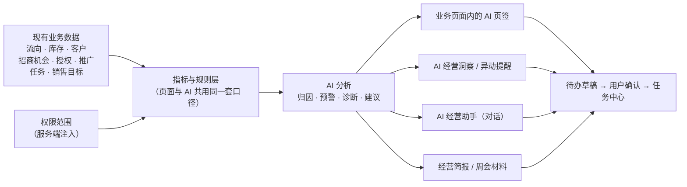

# 医药招商与流向库存系统 · AI 功能说明

2026-11-03 · 基于 Demo V0.2

客户已有的查询、报表和招商管理功能保持不变。我们在这些页面和现有数据之上增加 AI 分析，把"看数据"变成"知道哪里出了问题、应该先处理什么"，帮助管理者和业务人员提升经营与管理效率。

---

## 一、定位：不重复造轮子

AI 不替代客户现有的功能，而是贴在这些功能旁边，回答"数据说明了什么、接下来该做什么"。遵循四条原则：

1. **用现有数据**：只使用系统已有的数据，包括流向、库存、客户、招商机会、授权、推广、任务和销售目标，不要求客户额外录入。
2. **嵌进现有页面**：诊断以页签形式放在对应的业务页面里，用户不用切换系统，也不用另外打开报表。这些页面是招商进度管理、合伙人授权、库存管理和流向查询。
3. **结论直接给出**：打开页签就能看到指标、重点对象和 AI 分析，不需要再提问；想深入可以在 AI 助手中继续追问。
4. **建议落到行动**：分析结果可以生成待办草稿或简报，用户确认后进入任务中心，形成"发现 → 处理 → 跟踪"的闭环。

## 二、工作方式

关键点：**所有数字都由指标与规则层计算**，和页面上的报表是同一套口径；AI 负责组织结论、排优先级、给出建议，不自己编数字。

## 三、功能总览

目前共 11 项 AI 功能，覆盖销售管理、招商与渠道、库存运营、日常查询与汇报四类场景。

| # | AI 功能 | 解决的问题 | 用到的现有数据 | 在哪里用 | 产出 |
|---|---|---|---|---|---|
| 1 | 经营变化归因 | 销售涨跌了，但不知道是谁带来的 | 销售流向（含退货） | 经营工作台、销售对比表（AI 解释变化页签）、AI 助手 | 变化额、贡献最大的客户/品种及占比 |
| 2 | 客户流失预警 | 客户不进货了，发现时已经晚了 | 销售流向、客户、负责人 | AI 经营洞察、经营工作台 | 风险客户清单（高/中）、风险信号、回访待办 |
| 3 | 目标达成与缺口 | 不清楚进度落后多少、还差多少 | 销售流向、销售目标 | AI 经营洞察、AI 助手 | 达成率、缺口、与时间进度对比 |
| 4 | 团队与个人业绩分析 | 主管要逐个了解每个人的业绩和问题 | 流向、目标、招商机会、任务 | AI 经营洞察 · 销售业绩 | 个人业绩卡、排名、一对一沟通要点 |
| 5 | 招商漏斗诊断 | 招商机会卡在哪一步、哪些机会停滞 | 招商机会及阶段记录 | 招商进度管理 · AI 漏斗诊断 | 阶段转化率、最弱环节、卡点机会、推进待办 |
| 6 | 临期库存去化建议 | 临期批次可能卖不完，不知道卖给谁 | 批号库存、销售流向 | 库存管理 · AI 去化建议 | 到期前预计剩余量、候选客户、核查待办 |
| 7 | 授权与推广健康度 | 授权快到期、已生效却没人推广等问题难发现 | 合伙人授权、推广、销售流向 | 合伙人授权 · AI 健康诊断 | 健康分、问题清单、处理待办 |
| 8 | 流向查询结果分析 | 查出几百条记录，还要导出自己整理 | 进货/销售/仓储流向 | 三个流向查询页 · AI 分析当前结果 | 构成 Top5、同条件对比上期、数据质量问题 |
| 9 | 经营洞察与异动提醒 | 问题分散在各个报表里，没人主动提醒 | 全部业务数据 | AI 经营洞察、顶部"异动"铃铛 | 按优先级排序的洞察卡、提醒待办 |
| 10 | 经营简报与周会材料 | 每周、每月整理汇报材料很费时 | 以上各项分析结果 | AI 经营洞察 · 经营简报 | 可编辑的简报，可下载 Word/Markdown 或打印 |
| 11 | AI 经营助手 | 临时有问题，要找人或翻多个报表 | 全部业务数据 | 独立对话页、各页面右侧侧栏 | 问答、口径说明、查询编号、待办/简报草稿 |

## 四、按场景说明

> 以下示例数字均来自 Demo 演示数据（统计期 2026-10，对比 2026-09）。

### 4.1 销售管理（销售主管 / 经营负责人）

**① 经营变化归因**
- 自动比较本期与对比期的净销售额，退货按负数计入，找出贡献变化最大的客户和品种。
- 示例：10 月净销售额 ¥96 万，比 9 月的 ¥120 万下降 20%。其中杭州滨江仁济医院 −¥15 万、宁波海曙康宁大药房 −¥6 万，两家合计占降幅的 87.5%。
- 原因（如客户采购计划调整、竞品替代）单独列为"待核实"，不当作结论。

**② 客户流失预警**
- 按规则给每个客户打风险分，规则阈值可配置：

| 风险信号 | 加分 |
|---|---|
| 本月只有退货、没有进货 | +3 |
| 环比下降 ≥30% 且 ≥¥2 万（≥¥5 万时 +3） | +2 |
| 常规客户低于近 6 个月月均 ≥30%（≥50% 时 +2） | +1 |
| 常规客户连续未进货超过 max(30 天, 2 倍平时进货间隔)（≥45 天时 +3） | +2 |
| 连续两个月下滑 | +1 |

- 得分 ≥2 纳入清单，≥4 为高风险。演示数据中识别出 14 家风险客户，其中高风险 7 家。
- 可以按负责人筛选；对高风险客户一键生成回访待办草稿。

**③ 目标达成与缺口**
- 按负责人和区域对比目标与实际，给出达成率、缺口，以及与时间进度的差距（例如 Q4 已过 33/92 天）。
- 示例：10 月目标 ¥120 万，实际 ¥96 万，达成 80%，缺口 ¥24 万。

**④ 团队与个人业绩分析**
- 每位负责人一张业绩卡，包含：
  - 达成率排名、近 6 个月趋势、Q4 进度；
  - 主要下滑的客户和品种；
  - 风险客户数、流失与新增客户、招商跟进逾期、待办逾期。
- 示例：林悦 92.2%、赵宁 85.5%、陈晓 60.1%。
- 点"AI 业绩分析"可以生成个人分析，以及一对一沟通要点的待办草稿。

### 4.2 招商与渠道

**⑤ 招商漏斗诊断**（招商进度管理 · AI 漏斗诊断页签）
- 统计各阶段累计到达数和逐级转化率，标出转化最低的环节。
- 示例：线索登记 12 → 需求沟通 10（83%）→ 资料确认 8（80%，最弱）→ 合作洽谈 7（88%）→ 合作确认 6（86%）；成交率 86%。
- 标出"卡点机会"，即进行中、且在当前阶段停留超过 30 天的机会。例如 OPP-2026-005 在"合作洽谈"阶段已停留 44 天，下次跟进也已逾期。
- 列表新增"阶段停留"列；点击漏斗中的阶段，列表会按该阶段筛选。

**⑦ 授权与推广健康度**（合伙人授权 · AI 健康诊断页签）
- 自动检查以下问题：
  - 即将到期（30 天内）；
  - 新版本待确认；
  - 生效中但没有执行中的推广；
  - 推广执行中，但授权范围内 90 天没有销售；
  - 授权已暂停，推广仍在执行；
  - 授权范围重叠；
  - 授权已到期。
- 按问题扣分（高 35 / 中 20 / 提示 8）得出健康分，用于排序。示例：8 份未终止授权中 2 份需处理。AUTH-008 将在 22 天后到期，且没有执行中的推广，健康分 45。
- 授权列表新增可排序的"AI 健康分"列；授权详情页也显示该授权的诊断。

### 4.3 库存运营

**⑥ 临期库存去化建议**（库存管理 · AI 去化建议页签）
- 找出按近 30 日日均销量、到期前仍然卖不完的合格临期批次。
- 为每个批次匹配近 6 个月买过同品种的客户作为候选，同省优先，取前 3 家。
- 示例：B2511X1 芬舒 布洛芬缓释胶囊，库存 300 盒，25 天后到期，日均 8 盒，预计剩余 100 盒。候选客户为宁波济民医院、杭州中瑞药业商贸、杭州益丰源大药房。
- 批号列表新增"AI 去化"列，鼠标悬停可看候选客户；可以生成核查待办。

### 4.4 日常查询与汇报

**⑧ 流向查询结果分析**（进货 / 销售 / 仓储流向查询 · AI 分析当前结果页签）
- 分析当前筛选条件下的查询结果，并用同样的筛选条件对比上一期。整月查询按月对比，其他区间按相同天数往前推。
- 产出：
  - 药品构成和客户/供应方/仓库构成的 Top5，以及各自的变化；
  - 变化主要来自哪些对象；
  - 数据质量问题：迟到导入、有效期缺失、客户未映射、使用别名。
- 进货页另外检查短效期到货（剩余效期不足 180 天）和同一药品单价差异（≥5%）。仓储页提示同一业务事件出现在多个来源系统，避免重复相加。

**⑨ 经营洞察与异动提醒**（AI 经营洞察）
- 自动扫描销售、目标、客户、库存、招商授权、数据质量六类问题，生成洞察卡，并按高 / 中 / 提示排序。演示数据共 13 条，其中高优先 6 条。
- 页面分为"概览 / 销售业绩 / 洞察清单 / 经营简报"四个页签。顶部"异动"铃铛显示高优先数量。
- "生成提醒待办"可以勾选洞察、指定负责人和截止日期，批量保存；同一天同一异动不会重复生成。

**⑩ 经营简报与周会材料**（AI 经营洞察 · 经营简报页签）
- **月度经营简报**：包括经营概况、变化贡献、待核实事项、库存风险、数据质量和建议跟进事项。
- **销售周会材料**：共 7 部分，分别是业绩与目标、变化归因、风险客户、库存风险、招商与授权、团队情况、下周重点。
- 可以在线编辑、恢复为 AI 原稿，可以下载 Word / Markdown，也可以打印或导出 PDF。简报标注"AI 草稿 · 未发送"。

**⑪ AI 经营助手**
- 独立对话页，另外每个页面右上角都能打开侧栏。侧栏会带上当前页面的筛选条件作为上下文。
- 支持的问题示例：
  - 解释 10 月销售变化
  - 哪些客户有流失风险
  - 10 月目标完成情况和缺口
  - 分析陈晓的业绩
  - 招商漏斗诊断
  - 临期库存去化建议
  - 授权与推广健康度
  - 生成本周销售周会材料
  - 生成本月经营简报
- 每个回答附口径说明、查询编号和数据截止时间，可以继续追问。

## 五、现有功能 vs 加上 AI

| 页面 | 现有功能（客户已有） | 加上 AI 后 |
|---|---|---|
| 经营工作台 | KPI、趋势图、排行 | 一句话解释本月变化，风险与待办（含流失风险客户），一键进入分析 |
| 销售对比 / 流向查询 | 按条件查明细、导出 | 直接看到构成、变化贡献、同条件对比上期和数据质量问题，不用导出再整理 |
| 招商进度管理 | 机会列表、看板、阶段变更 | 漏斗转化、最弱环节、卡点机会和推进待办 |
| 合伙人授权 | 授权列表、版本、状态管理 | 健康分和问题清单（到期、无推广、暂停仍推广、重叠） |
| 库存管理 | SKU / 批号库存、临期筛选 | 到期前卖不完的批次、预计剩余量和候选客户 |
| 任务中心 | 待办管理 | AI 发现的问题以草稿形式进入，确认后成为待办，形成闭环 |
| （新增）AI 经营洞察 | — | 主动扫描异动，汇总团队业绩，一键生成简报和周会材料 |

## 六、可信与可控

- **数字有来源**：所有数字来自指标与规则层，和页面报表口径一致。每个结论附口径说明、查询编号和数据截止时间，可以追溯。
- **观察与推测分开**：数据能证明的列为"数据观察"，需要人判断的原因列为"待核实"，不把推测当结论。
- **遵守口径规则**：
  - 不跨品种、跨单位（盒/瓶/支）合计数量；
  - 退货按负数计算；
  - 对比基数 ≤0 时不显示变化率；
  - 缺失、0、未知三种状态分开显示。
- **权限一致**：AI 只能看到当前用户有权限的数据，例如区域业务人员只能看到浙江和对应仓库。权限由服务端注入，不由 AI 决定。
- **人做决定**：AI 只生成草稿，待办和简报都要用户确认后才保存。AI 不会自动审批、变更状态、下单调拨或对外发送。
- **阈值可配置**：卡点天数、临期窗口、风险评分、健康分扣分等都是规则参数，可以按客户的业务习惯调整。

## 七、当前状态与下一步

**当前状态**
- 以上功能已在 Demo 中实现。AI 目前为"规则解析模式"，没有接入大模型，能识别示例问题及其变体。
- 核心演示数字已用自动化测试锁定，例如 10 月销售下降归因、临期批次剩余量、流失风险判定。

**下一步建议**
1. **接入大模型**：提升自然语言理解和结论表述。数字仍由指标层计算；模型不可用时，报表和规则诊断照常工作。
2. **对接客户真实数据**：在客户现有数据库或接口上接入，不改造现有功能。
3. **与客户校准规则阈值**：比如流失预警的判定标准、卡点天数、候选客户的选择规则。
4. **定时推送**：每周自动生成周会材料草稿，每天推送异动提醒（仍需确认后才对外发送）。

**待确认事项**
- 客户的销售目标数据目前在哪个系统、按什么粒度维护（负责人 × 区域 × 月）？
- 优先在哪几个页面上线 AI 诊断？
- 大模型的部署方式（公有云 / 私有化）及数据合规要求。
